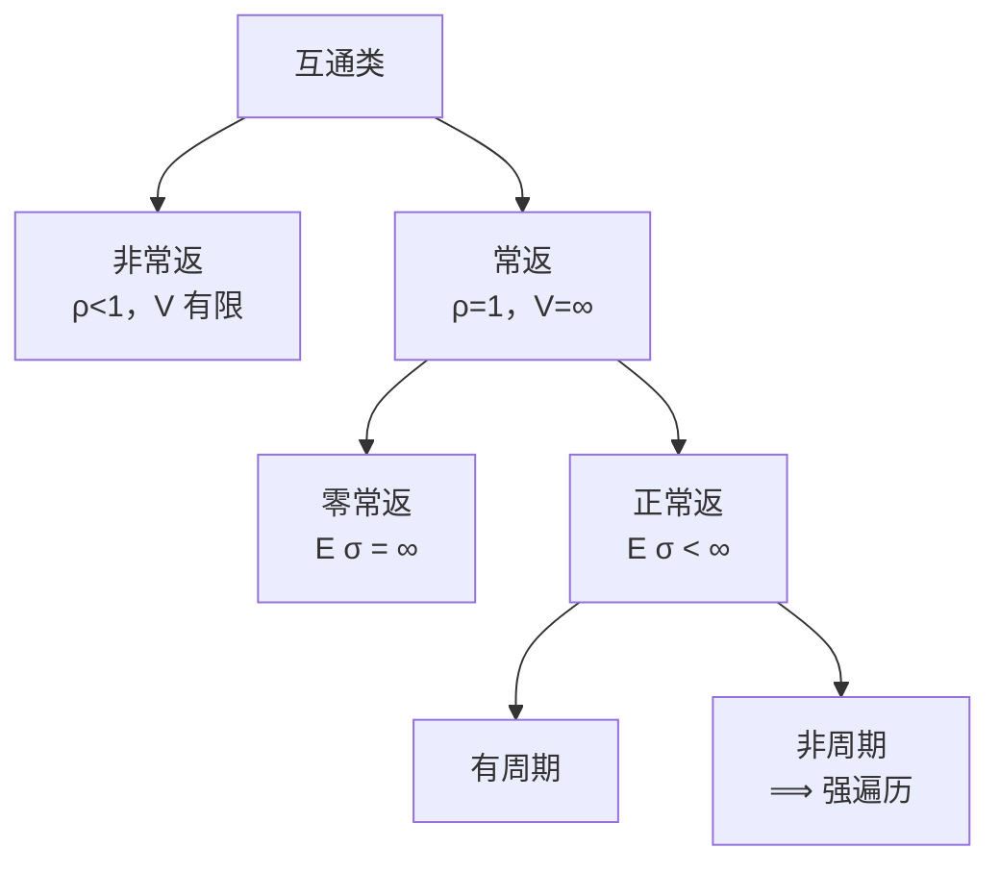

> 覆盖第 0 章与 §1.1–§1.11（第 1–11 讲，第 1 章全部）。目的：**把记号理顺**，弄清每个量"是什么类型的东西、依赖什么、和谁有关系"。
> 本课的难度很大一部分来自记号：同一个字母在不同地方指不同东西，相近的符号又只差一个下标。本页统一记号，并标出所有容易混淆的地方。

---

### 0. 读记号的三条规律

1. **下标写在 $$P$$、$$E$$ 上 = 起点（初分布）**
   $$
   P_i(\cdot)=P(\cdot\mid X_0=i),\qquad P_\mu(\cdot)=\sum_i\mu_iP_i(\cdot),\qquad E_i,\ E_\mu\ \text{同理}.
   $$
   看到 $$P_i(\tau_j<\infty)$$，读作"**从 $$i$$ 出发**，到达 $$j$$ 的时刻有限"。
2. **小写 $$p$$ 带两个下标 = 转移概率（矩阵元素）**；上标 $$(n)$$ = 走 $$n$$ 步。
   $$
   p_{ij}=P(X_{n+1}=j\mid X_n=i),\qquad p_{ij}^{(n)}=P_i(X_n=j)=(P^n)_{ij}.
   $$
3. **每个记号先问"它是哪一类"**：

| 类型 | 典型记号 | 取值 | 是否随机 |
|---|---|---|---|
| 状态 | $$i,j,k,o\in S$$ | $$S$$ 中元素 | 否 |
| 随机时刻 | $$\tau_i,\ \sigma_i,\ \tau_D,\ T_r$$ | $$\{0,1,2,\dots\}\cup\{+\infty\}$$ | **是** |
| 计数 | $$V_i,\ V_i(n),\ R_n$$ | 非负整数或 $$+\infty$$ | **是** |
| 概率 / 期望 | $$\rho_i,\ x_i,\ G_{ij},\ E_i\sigma_i$$ | 数 | 否 |
| 测度 / 分布 | $$\mu,\ \pi,\ \mu^{(o)}$$ | $$S$$ 上的非负向量 | 否 |

⚠️ **随机时刻和计数可以以正概率取 $$+\infty$$**（约定 $$\inf\emptyset=+\infty$$）。是否有限需要证明，这正是本章大量命题在做的事。

---

### 1. 记号总表

#### 1.1 基本对象（§1.1）

| 记号 | 含义 | 备注 |
|---|---|---|
| $$S$$ | 状态空间 | 离散，可以无限 |
| $$\{X_n\}_{n\ge0}$$ | 马氏链 | 时齐 |
| $$P=(p_{ij})_{i,j\in S}$$ | 转移矩阵 | $$p_{ij}\ge0$$，$$\sum_jp_{ij}=1$$ |
| $$p_{ij}^{(n)}$$ | $$n$$ 步转移概率 $$=(P^n)_{ij}$$ | $$p_{ij}^{(0)}=\mathbf 1_{\{i=j\}}$$ |
| $$\mu$$ | 初分布（**行向量**） | $$X_n\sim\mu P^n$$ |
| $$P_\mu,\ P_i,\ E_\mu,\ E_i$$ | 指定起点的概率 / 期望 | 见第 0 节 |

**有限维分布**：
$$
P_\mu(X_0=i_0,X_1=i_1,\dots,X_n=i_n)=\mu_{i_0}\,p_{i_0i_1}\cdots p_{i_{n-1}i_n}.
$$
**C-K 方程**：
$$
p_{ij}^{(n+m)}=\sum_kp_{ik}^{(n)}p_{kj}^{(m)}.
$$

#### 1.2 测度与分布（§1.2、§1.8）

| 记号 | 定义 | 归一化？ |
|---|---|---|
| 不变测度 | $$\pi P=\pi$$，即 $$\sum_j\pi_jp_{ji}=\pi_i$$ | 不要求 |
| **不变分布** $$\pi$$ | 不变测度，且 $$\sum_i\pi_i=1$$ | 要求 |
| 配称（可逆）测度 / 分布 | $$\pi_ip_{ij}=\pi_jp_{ji}$$，$$\forall\,i,j$$（细致平衡） | 视情况 |
| $$\mu^{(o)}$$ | $$\mu^{(o)}_i=E_o\sum_{n=0}^{\sigma_o-1}\mathbf 1_{\{X_n=i\}}$$ | 总和 $$=E_o\sigma_o$$ |

- 包含关系：**可逆 ⟹ 不变**（每条边双向流量相等 ⟹ 每点流入 = 流出）。反之不成立。
- $$\mu^{(o)}$$：从 $$o$$ 出发、回到 $$o$$ **之前**访问 $$i$$ 的平均次数；$$\mu^{(o)}_o=1$$。
  > ⚠️ 课上把它也记作 $$\mu_i$$，与**初分布 $$\mu$$** 同一个字母！本页一律写 $$\mu^{(o)}$$，标明参考点 $$o$$。

#### 1.3 随机时刻（§1.4、§1.5）

| 记号 | 定义 | 读法 |
|---|---|---|
| $$\tau_i$$ | $$\inf\{n\ge0:X_n=i\}$$ | **首达时**（含 $$n=0$$） |
| $$\sigma_i$$ | $$\inf\{n\ge1:X_n=i\}$$ | **首入时 / 回访时**（不含 $$n=0$$） |
| $$\tau_D$$ | $$\inf\{n\ge0:X_n\in D\}$$ | 首达集合 $$D$$ |
| $$\tau_{D^c}$$ | $$\inf\{n\ge0:X_n\notin D\}$$ | 首次**离开** $$D$$ |
| $$T_r$$ | $$T_0=0$$，$$T_r=\inf\{n\ge T_{r-1}+1:X_n=i\}$$ | 第 $$r$$ 次到达 $$i$$ |
| $$\sigma_r$$ | $$T_r-T_{r-1}$$（$$T_{r-1}=\infty$$ 时规定为 $$\infty$$） | 第 $$r$$ 段间隔 |
| $$\varepsilon_n$$ | $$\max\{m\le n:S_m=0\}$$ | SRW 最后一次在 $$0$$ 的时刻 |

- $$X_0\ne i$$ 时 $$\tau_i=\sigma_i$$；$$X_0=i$$ 时 $$\tau_i=0$$，而 $$\sigma_i$$ 是**回来**的时刻。
- $$X_0=i$$ 时 $$T_1=\sigma_i$$；$$X_0\ne i$$ 时 $$T_1=\tau_i$$。
- **游离（excursion）**：两次相邻到达 $$i$$ 之间的一段轨道 $$(X_{T_{r-1}},\dots,X_{T_r})$$。

> ⚠️ **$$\sigma$$ 的两种用法**：$$\sigma_i$$（下标是**状态**）是首入时；$$\sigma_r$$（下标是**序号**）是第 $$r$$ 段间隔。从 $$i$$ 出发时 $$\sigma_1=\sigma_i$$，且常返时 $$\sigma_1,\sigma_2,\dots$$ i.i.d. 同分布于 $$\sigma_i$$。看到 $$\sigma$$ 先判断下标是状态还是序号。

#### 1.4 计数（§1.2、§1.5、§1.8）

| 记号 | 定义 | 范围 |
|---|---|---|
| $$V_i$$ | $$\sum_{n=0}^{\infty}\mathbf 1_{\{X_n=i\}}$$ | **全部时间**访问 $$i$$ 的次数 |
| $$V_i(n)$$ | $$\sum_{m=0}^{n-1}\mathbf 1_{\{X_m=i\}}$$ | **前 $$n$$ 步**（$$0$$ 到 $$n-1$$）访问次数 |
| $$V_i^{(Y)}$$ | 新链 $$Y_n=X_{\tau+n}$$ 访问 $$i$$ 的次数 | 强马氏性证明中用 |
| $$R_n$$ | $$\max\{r\ge0:S_r\le n\}$$ | 更新过程：到 $$n$$ 为止的更新次数 |

> ⚠️ $$V_i$$ 与 $$V_i(n)$$ 只差一个括号：前者可能是 $$+\infty$$，用于**常返**；后者有限，$$V_i(n)/n$$ 是**频率**，用于**遍历**。

#### 1.5 由时刻 / 计数导出的数（§1.5–§1.8）

| 记号 | 定义 | 意义 |
|---|---|---|
| $$\rho_i$$ | $$P_i(\sigma_i<\infty)$$ | 从 $$i$$ 出发能回到 $$i$$ 的概率 |
| $$x_i$$（击中概率） | $$P_i(\tau_D<\infty)$$ | 从 $$i$$ 出发能到达 $$D$$ |
| $$G_{ij}$$（格林函数） | $$E_iV_j=\sum_{n\ge0}p_{ij}^{(n)}$$ | 从 $$i$$ 出发访问 $$j$$ 的平均总次数 |
| $$G^{(D)}_{ij}$$ | $$E_i\sum_{n=0}^{\tau_{D^c}-1}\mathbf 1_{\{X_n=j\}}$$ | 离开 $$D$$ 前访问 $$j$$ 的平均次数（$$i,j\in D$$） |
| $$E_i\sigma_i$$ | 平均回访时间 | 正常返 ⟺ 有限 |
| $$d_{TV}(\mu,\nu)=\lVert\mu-\nu\rVert$$ | $$\frac12\sum_i\lvert\mu_i-\nu_i\rvert=\sup_A\lvert\mu(A)-\nu(A)\rvert$$ | 全变差距离（§1.10），$$\le1$$ |

---

### 2. 最容易混淆的几组

| 容易混的 | 区别 | 一句话判别 |
|---|---|---|
| $$\tau_i$$ vs $$\sigma_i$$ | $$n\ge0$$ vs $$n\ge1$$ | 起点就是 $$i$$ 时，$$\tau_i=0$$，$$\sigma_i$$ 要"回来" |
| $$\sigma_i$$ vs $$\sigma_r$$ | 下标是状态 vs 序号 | 见 1.3 节 |
| $$V_i$$ vs $$V_i(n)$$ | 全部 vs 前 $$n$$ 步 | 常返看 $$V_i$$，频率看 $$V_i(n)/n$$ |
| 初分布 $$\mu$$ vs $$\mu^{(o)}$$ | 出发分布 vs 构造的不变测度 | 有没有参考点 $$o$$ |
| 不变 vs 可逆 | 每点平衡 vs 每边平衡 | 可逆更强 |
| 测度 vs 分布 | 总和可以 $$=\infty$$ vs 总和 $$=1$$ | 能否归一化 |
| $$i\to j$$ vs $$P_i(\tau_j<\infty)=1$$ | **正概率**到达 vs **必然**到达 | 可达只要 $$>0$$ |
| 常返 vs 正常返 | $$P_i(\sigma_i<\infty)=1$$ vs 再加 $$E_i\sigma_i<\infty$$ | 零常返 = 常返但平均回访时间无穷 |
| $$p_{ij}^{(n)}\to\pi_j$$ vs $$\frac1n\sum_{m<n}p_{ij}^{(m)}\to\pi_j$$ | 强遍历 vs 弱（Cesàro）遍历 | 强的要**非周期** |
| $$f^{(n)}$$（§1.11 板书） | $$f$$ 的 $$n$$ 次**复合** vs $$n$$ 阶导数 | 分支过程中指复合，笔记写作 $$f^{\circ n}$$ |
| $$P$$ vs $$\hat P=P^d$$ | 原链 vs 周期 $$d$$ 时每 $$d$$ 步看一次 | $$\hat P$$ 在每个循环类 $$D_r$$ 上非周期 |
| $$P_\mu(X_n=j)$$ vs $$\frac{V_j(n)}n$$ | 分布（数） vs 频率（随机变量） | 分布视角 vs 轨道视角 |

> 💡 贯穿全课的两个视角：**分布**（$$\mu P^n$$、$$\pi$$、$$p_{ij}^{(n)}$$）与**轨道**（$$\tau,\sigma,V,$$ 频率）。几乎每个结论都有两个版本。

---

### 3. 核心关系一览（把记号串起来）

**(1) 回访与计数**：
$$
P_i(T_r<\infty)=\rho_i^{\,r},\qquad P_i(V_i\ge r+1)=\rho_i^{\,r}\quad\Longrightarrow\quad V_i\ \text{在 }P_i\text{ 下服从几何分布}.
$$
$$
G_{ii}=E_iV_i=\frac1{1-\rho_i}\qquad(\rho_i=1\text{ 时为 }+\infty).
$$

**(2) 常返的四种等价说法**：
$$
\rho_i=1\iff P_i(V_i=\infty)=1\iff E_iV_i=\infty\iff G_{ii}=\sum_np_{ii}^{(n)}=\infty.
$$
（"期望无穷 ⟹ 几乎必然无穷"一般不成立，这里成立是因为 $$V_i$$ 服从几何分布。）

**(3) 非对角与对角格林函数**：
$$
G_{ij}=P_i(\tau_j<\infty)\,G_{jj}.
$$

**(4) 不变分布与回访时间**（不可约）：
$$
\pi_i=\frac1{E_i\sigma_i},\qquad\mu^{(o)}_i=\frac{E_o\sigma_o}{E_i\sigma_i}=\frac{\pi_i}{\pi_o},\qquad\sum_i\mu^{(o)}_i=E_o\sigma_o.
$$

**(5) 频率与分布**（不可约）：
$$
\frac{V_i(n)}n\xrightarrow{a.s.}\frac1{E_i\sigma_i}\quad(\text{正常返时}=\pi_i).
$$

**(6) 期望时间与区域格林函数**：
$$
E_i\tau_{D^c}=\sum_{j\in D}G^{(D)}_{ij}.
$$

**(7) 首步分析的三个标准方程**（最常考的计算方式）：

| 求什么 | 方程（$$i$$ 不在目标中） | 边界条件 | 解的选取 |
|---|---|---|---|
| 击中概率 $$x_i=P_i(\tau_D<\infty)$$ | $$x_i=\sum_jp_{ij}x_j$$ | $$x_i=1,\ i\in D$$ | **最小非负解** |
| 期望时间 $$y_i=E_i\tau_{D^c}$$ | $$y_i=1+\sum_jp_{ij}y_j$$（$$i\in D$$） | $$y_i=0,\ i\notin D$$ | 走一步要 $$+1$$ |
| 区域格林函数 $$x_i=G^{(D)}_{io}$$ | $$x_i=\sum_jp_{ij}x_j$$（$$i\in D,\ i\ne o$$） | $$x_o=1+\sum_jp_{oj}x_j$$；$$x_i=0,\ i\notin D$$ | 从 $$o$$ 出发第 $$0$$ 步算一次 |

---

### 4. 状态分类体系

#### 4.1 分类树

**以上每一种性质都是互通类的性质**（同一类中所有状态同时具备或同时不具备）。

#### 4.2 定义与判别

| 性质 | 定义 | 常用判别 / 等价条件 |
|---|---|---|
| 可达 $$i\to j$$ | $$P_i(\exists\,n\ge0,X_n=j)>0$$ | $$\exists\,n$$，$$p_{ij}^{(n)}>0$$ ⟺ 图上有有向路径 |
| 互通 $$i\leftrightarrow j$$ | $$i\to j$$ 且 $$j\to i$$ | 等价关系，划分互通类 |
| 不可约 | 所有状态互通 | 只有一个互通类 |
| 闭集 $$A$$ | $$p_{ij}=0$$，$$\forall\,i\in A,\ j\notin A$$ | 只进不出 |
| 常返 | $$P_i(V_i=\infty)=1$$ | $$G_{ii}=\infty$$；不可约时 ⟺ 击中方程在 $$[0,1]$$ 上只有恒 $$1$$ 解 |
| 正常返 | $$E_i\sigma_i<\infty$$ | 不可约时 ⟺ **存在不变分布** |
| 零常返 | 常返且 $$E_i\sigma_i=\infty$$ | 常返 + 不变测度不能归一化 |
| 非周期 | $$\exists\,N$$，$$\forall\,n>N$$，$$p_{ii}^{(n)}>0$$ | $$p_{ii}>0$$ 即足够 |

**几条结构性事实**：

- 常返类必闭；闭的**有限**互通类必常返。
- 有限不可约链 ⟹ 正常返，不变分布存在。
- 零常返只出现在**无限**状态空间中。
- 非常返态 $$j$$：$$p_{ij}^{(n)}\to0$$，且任何不变分布都有 $$\pi_j=0$$。

---

### 5. 主线定理链

🗺 第 1 章的核心问题：**$$p_{ij}^{(n)}$$ 何时收敛？不变分布何时存在、唯一？**

| § | 结论 | 条件 |
|---|---|---|
| 1.1 | 马氏性：已知现在，未来是同一马氏链，且与过去独立 | — |
| 1.4 | **强马氏性**：从 $$\tau_i$$（或 $$\sigma_i$$）往后看，仍是从 $$i$$ 出发的同一马氏链，且与之前独立 | 在 $$\{\tau_i<\infty\}$$ 上 |
| 1.5 | $$V_i$$ 服从几何分布；常返是类性质 | — |
| 1.6 | 击中概率是首步方程的最小非负解 | — |
| 1.7 | $$i$$ 常返 ⟺ $$G_{ii}=\infty$$；Pólya：SRW $$d\le2$$ 常返，$$d\ge3$$ 非常返 | — |
| 1.8.1 | $$\dfrac{V_i(n)}n\to\dfrac1{E_i\sigma_i}$$ a.s. | 不可约，任意 $$\mu$$ |
| 1.8.2 | 若 $$\pi$$ 存在，则 $$\pi_i=\dfrac1{E_i\sigma_i}>0$$，唯一 | 不可约 |
| 1.8.4 | $$\mu^{(o)}$$ 是不变测度 | $$o$$ 常返 |
| 1.8.5 | 全正常返 ⟺ 存在正常返态 ⟺ 存在不变分布 | 不可约 |
| 1.8.10 | 遍历定理：$$\frac1n\sum_{m<n}f(X_m)\to\sum_i\pi_if(i)$$ a.s. | 不可约、正常返、$$\sum\pi_i\lvert f(i)\rvert<\infty$$ |
| 1.9.3 | 强遍历：$$\sum_j\lvert P_\mu(X_n=j)-\pi_j\rvert\to0$$ | 不可约、正常返、**非周期** |
| 1.9.6 | 周期 $$d$$：$$S=D_0\sqcup\cdots\sqcup D_{d-1}$$ 循环；$$p_{ij}^{(nd+s)}\to d\,\pi_j$$（$$i\in D_r,\ j\in D_{r+s}$$） | 不可约、正常返 |
| 1.9.9 | 零常返：$$p_{ij}^{(n)}\to0$$（但 $$\sum_np_{ij}^{(n)}=\infty$$） | 不可约、零常返 |
| 1.10.1 | Dobrushin：$$\lVert\mu P-\nu P\rVert\le(1-N\delta)\lVert\mu-\nu\rVert$$，$$\delta=\min p_{ij}$$ | $$S$$ 有限，$$p_{ij}>0$$ |
| 1.10.2 | 指数收敛：$$d_{TV}(\mu P^n,\pi)\le Ce^{-\beta n}$$ | $$S$$ 有限、不可约、非周期 |
| 1.11.3 | 分支过程灭绝概率 $$\rho$$ = $$s=f(s)$$ 的最小非负根；$$\rho<1\iff m>1$$ | $$p_1\ne1$$ |

> 读法：越往下，条件越多，结论越强。**不可约**是 §1.8–§1.9 的默认前提。

---

### 6. 证明工具箱

| 工具 | 什么时候用 | 典型出处 |
|---|---|---|
| **全概率拆分** | 把事件拆到"固定长度的状态向量"，逐块用有限维分布 | 马氏性、C-K、命题 1.5.1 |
| **首步分析** | 求击中概率、期望时间、格林函数 | §1.6–§1.7 |
| **强马氏性 + 随机对齐** | 到达某状态后"重新开始"，比较两条链的计数 | 命题 1.5.6、1.7.4、定理 1.8.1 |
| **游离分解 + 强大数律** | 把轨道切成 i.i.d. 的段 | 更新定理、遍历定理 |
| **尾项引理**（推论 0.3.2） | i.i.d. 且期望有限，则 $$\xi_n/n\to0$$ a.s. | 处理最后不完整的一段 |
| **有界收敛定理** | 频率 $$\le1$$，可以交换极限与期望 | 命题 1.8.2、遍历定理 |
| **交换求和**（非负 / Fubini） | $$E\sum=\sum E$$；$$\sum_n\sum_i=\sum_i\sum_n$$ | 格林函数、$$\sum_i\mu^{(o)}_i$$ |
| **把随机上限换成 $$\infty$$** | $$\sum_{n=0}^{\sigma-1}=\sum_{n\ge0}\mathbf 1_{\{n<\sigma\}}$$ | 命题 1.8.4 |
| **流量平衡** | 选集合 $$A$$，流入 = 流出，一步得到递推 | 不变分布计算 |
| **升维** | 有限阶记忆、跳跃 $$(X_n,X_{n+1})$$ | C-K 后讨论、例 1.8.15 |
| **反射原理** | SRW 首达时的分布 | §1.4 二 |
| **耦合** | 两条链独立运行，相遇后同分布 | 强遍历定理 |

---

### 7. 标准例子速查

| 例子 | 状态空间 | 分类 | 不变分布 / 关键结论 |
|---|---|---|---|
| 两状态链 $$p_{01}=p,\ p_{10}=q$$ | $$\{0,1\}$$ | 正常返 | $$\pi=\big(\frac q{p+q},\frac p{p+q}\big)$$；$$0<p+q<2$$ 时 $$P^n\to$$ 每行为 $$\pi$$ |
| 一维 SRW | $$\mathbb Z$$ | **零常返** | 无不变分布；$$E_0\tau_1=\infty$$；$$p_{00}^{(2n)}\sim\frac1{\sqrt{\pi n}}$$ |
| 二维 SRW | $$\mathbb Z^2$$ | 零常返 | $$p_{00}^{(2n)}\sim\frac1{\pi n}$$（临界） |
| $$d\ge3$$ 维 SRW | $$\mathbb Z^d$$ | 非常返 | $$p_{00}^{(2n)}\asymp n^{-d/2}$$ |
| $$\mathbb Z$$ 上紧邻 RW，$$p\ne q$$ | $$\mathbb Z$$ | 非常返 | 不变测度不唯一；$$p>q$$ 时 $$P_0(\tau_{-1}<\infty)=\frac qp$$ |
| 生灭链（$$0$$ 反射） | $$\mathbb Z_+$$ | 常返 ⟺ $$R=\infty$$；正常返 ⟺ $$C<\infty$$ | $$\pi_i=\pi_0\frac{b_0\cdots b_{i-1}}{d_1\cdots d_i}$$，$$\pi_0=\frac1C$$（可逆） |
| 余寿链（更新过程） | $$\mathbb Z_+$$ | 常返；正常返 ⟺ $$EL<\infty$$ | $$\pi_i=\frac{P(L\ge i+1)}{EL}$$ |
| 例 1.2.7（右跳多格、左跳一格） | $$\mathbb Z_+$$ | 不变分布存在 ⟺ $$m<\lambda$$ | $$\pi_0=\frac{\lambda-m}{2\lambda-m+1}$$ |
| 树 $$T^d$$ 上 $$\lambda$$-biased RW | 树 | $$\lambda>d$$ 正常返；$$\lambda=d$$ 零常返；$$\lambda<d$$ 非常返 | $$\pi_i=c_{\lvert i\rvert}=\frac{\lambda^{-\lvert i\rvert}}R$$ |
| 有限连通图上的 SRW | 图的顶点 | 正常返（可逆） | $$\pi_i=\frac{d_i}{\sum_kd_k}$$ |
| Ehrenfest 模型 | $$\{0,\dots,N\}$$ | 正常返，**周期 2** | $$\pi_i=\binom Ni2^{-N}$$；$$E_i\sigma_i=\frac{2^N}{\binom Ni}$$；强遍历不成立 |
| 赌徒破产（SRW 在 $$0,N$$ 吸收） | $$\{0,\dots,N\}$$ | — | $$P_k(\tau_N<\tau_0)=\frac kN$$；$$E_i(\tau_0\wedge\tau_N)=i(N-i)$$ |
| Wright–Fisher（带变异 $$0<u,v<1$$） | $$\{0,\dots,N\}$$ | 正常返、非周期 | 平稳均值 $$\frac{Nv}{u+v}$$；$$u=v=0$$ 时 $$0,N$$ 吸收 |
| Galton–Watson 分支过程 | $$\mathbb Z_+$$ | $$0$$ 吸收，其余非常返 | $$EX_n=m^n$$；$$f_{X_n}=f^{\circ n}$$；几何子代分布时 $$\rho=\min\{1,\frac1m\}$$ |

其中生灭链的两个量：
$$
R=1+\sum_{k\ge1}\frac{d_1\cdots d_k}{b_1\cdots b_k},\qquad C=1+\sum_{k\ge1}\frac{b_0b_1\cdots b_{k-1}}{d_1\cdots d_k};
$$
树上随机游动的 $$R=\sum_{n\ge0}(d/\lambda)^n$$。

---

> 各结论的完整推导见对应各讲笔记（01–09）。本页只统一记号、整理结构，不引入新内容；记号 $$\mu^{(o)}$$ 是本页为避免与初分布混淆而加的标注。
