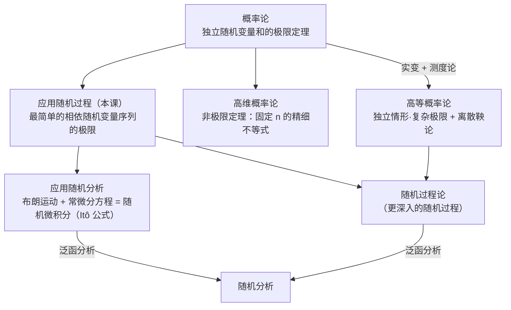

> 📅 2026-09-10（周四）第 7–8 节 ｜ 📖 对应教材：无（铺垫内容）＋ 第 0 章导读
> 🎞 来源：课堂转写 + 7 张板书（`板书/应用随机过程_2026-09-10_第7-8节/`）

---

### 0. 本讲要点速览

- 这门课**是理论数学课，与"应用"无关**；难度与微分流形、数值代数等专业课持平。
- 概率方向课程体系：概率论 → 应用随机过程 / 高维概率论 / 应用随机分析 → 高等概率论 → 随机过程论 → 随机分析。
- 概率论按**模型与方法**分为 **离散** 与 **连续** 两大类，研究方法差异很大。
- 本课按 **时间 × 状态** 分为三章；第 1 章结束后期中考试。
- 随机过程中的随机变量（如随机时刻）**可能以正概率取 $$+\infty$$**，需要证明而非默认。

---

### 1. 课程信息

| 项目 | 内容 |
|---|---|
| 课程 | 应用随机过程 |
| 任课教师 | **葛颢**（北京国际数学研究中心长聘教授、北京大学生物医学前沿创新中心 BIOPIC 研究员；北大概率方向博士，2008 年） |
| 时间 | 周二 3–4 节、周四 7–8 节 |
| 答疑 | 周二 7–8 节，综合科研 2 号楼 302（学五附近，老师办公室） |
| 助教 | 梅文九（音，以群内信息为准） |
| 作业 | **每周四交上一周的作业**（第一周周二的不用交） |
| 先修 | 概率论 或 概率统计 |
| 教材 | 陈大岳、章复熹《应用随机过程》，北京大学出版社，2023 |
| 参考书 | 见老师主页；如 G. Lawler《随机过程导论》（有中文版） |
| 成绩 | 作业 20% + 期中 30% + 期末 50% |
| 期中 | 第 1 章结束后，约第 9 周 |
| 期末 | **1 月 7 日（考试周第二周周四）下午** |

**老师的"丑话说在前头"：**

- 从不点名，只看作业与考试；但"不来上课的人绝大多数也不会看回放"。
- 给分相对宽松但**从不承诺**；**不接受任何形式的改分请求**。
- 期末卷**不可查分/查卷**；期中卷会发回，可提意见。
- 想走概率方向（尤其以后做研究）应选**实验班**；想偏应用可选其他院系的随机过程课。

---

### 2. 北大概率方向课程地图

| 阶段 | 课程 | 核心 |
|---|---|---|
| 本科 | 概率论 | 独立随机变量和的极限定理（大数定律、中心极限定理） |
| 本科 | **应用随机过程** | 把"独立"减弱：最简单的**相依**随机变量序列的极限定理 |
| 本科 | 高维概率论 | **非极限**定理：给定 $$n$$，找尽可能精细的概率不等式（集中不等式） |
| 本科 | 应用随机分析 | 布朗运动 + 常微分方程 → 随机微积分（"随机版牛顿–莱布尼茨公式"：Itô 公式） |
| 研究生 | 高等概率论 | 仍以独立情形为主，但条件更弱、极限更复杂；加上离散鞅论 |
| 研究生 | 随机过程论 | 在测度论基础上做更深入的随机过程 |
| 研究生 | 随机分析 | 泛函分析视角的随机微积分 |

- 研究生三门基础课学完可参加博士资格考试（qualify），但知识大约只到 **1950 年代**，之后要靠读文献、讨论班走向前沿。
- 统计方向博士通常也要求**高等概率论**（证明统计方法的性质）。
- "应用"二字是约 40 年前为区分本科/研究生课程而加的历史遗留，意为"本科、较简单"。

---

### 3. 随机过程简史与研究版图

**时间线**

- **20 世纪前半叶（1950 前）**：独立变量和、严格数学基础、布朗运动 —— 本课内容基本在此范围。
- **20 世纪后半叶至今**：极其多样化（以下偏理论）。

#### 3.1 两大类：离散 vs 连续

| | 离散 | 连续 |
|---|---|---|
| 典型方法 | 组合、优化、图论、概率方法（接近竞赛数学） | 分析：泛函分析、偏微分方程、微分流形 |
| 北大代表老师 | 丁剑、孙鑫、李欣意、陈大岳 等 | 刘勇、任艳霞 等 |

#### 3.2 一般理论

| 方向 | 离散 | 连续 |
|---|---|---|
| 存在唯一性 | 半群/生成元方法（1940–50s）；鞅问题（1970–80s） | |
| 具体模型的数学化 | **Ising 模型、渗流**模型严格定义（1950–70s）；**相互作用粒子系统**（1970–80s，代表人物 T. Liggett，陈大岳老师的导师） | **随机积分**（Itô，1940–50s；推广 1960–80s）→ 随机常微分方程 → **随机 PDE**（非奇异情形 1980–90s） |
| 其他 | | 鞅论（1940–60s）、**位势理论**（PDE 的解 = 某随机过程的期望） |

- 概率论的模型**大多来自外部**，最主要的输入是**物理（统计物理）**。
- 随机积分的物理动机：带电粒子做布朗运动时求外力做功，自然需要沿随机路径积分。早期物理工作包括王明贞与 Uhlenbeck 关于布朗运动的工作。
- 彭实戈：给一类非线性 PDE 构造了随机表示（倒向随机微分方程）。
- PDE 解写成随机过程的期望的好处：可以**蒙特卡罗模拟后求平均**来数值求解。随机梯度下降等算法的理解也依赖随机过程。

#### 3.3 具体问题

**离散侧**：标度（尺度）极限、可解（可积）模型、集中不等式、**轨道性质**、随机环境中的随机过程（陈大岳老师）。

**连续侧**：

- **奇异 SPDE**：Martin Hairer（2005–2014，正则结构理论，2014 年菲尔兹奖）。
- 热核估计、随机动力系统、**流体力学极限**（Guo–Papanicolaou–Varadhan，1988/89；Varadhan 2007 年获阿贝尔奖）、大偏差、噪声退化。

> **轨道性质举例：布朗运动的正则性**
>
> 轨道连续但非常粗糙，属于 $$C^{\frac12-}$$：对任意 $$\varepsilon>0$$，
> $$
> |f(x)-f(y)| \lesssim |x-y|^{\frac12-\varepsilon},
> $$
> 但达不到 $$\frac12$$，因而**处处不可导**。于是 $$\int_0^t g(x)\,\mathrm{d}f(x)$$ 在黎曼或勒贝格意义下都无法定义——这正是**随机积分**这一领域存在的原因。

#### 3.4 与其他学科的交叉

| 交叉领域 | 代表问题 / 模型 |
|---|---|
| 量子 / 统计物理 | **相变**（Ising 模型；Duminil-Copin 2022 年菲尔兹奖）、随机曲面、**SLE**（2006 年菲尔兹奖）、CLE、**随机量子化**（Parisi–吴咏时，1981 年发表于《中国科学》）、随机 Yang–Mills、**自旋玻璃** |
| 几何 / 代数 | **随机矩阵**（Wigner 半圆律，用于原子核能级）、流形上的随机过程、**群上的随机游动**（杨文元老师）、分形与 Hausdorff 维数 |
| 化学 / 生物 | **聚合物模型**（Flory，1974 年诺贝尔化学奖）、分支布朗运动（遗传）、化学反应模型 |
| 统计 / 计算机 | **随机图论**（丁剑与 Sly、Sun 合作确定随机 $$k$$-SAT 相变阈值）、算法收敛性、数据科学 |

#### 3.5 数学 vs 物理：杨振宁的"双叶"比喻

数学与物理同根而生，但像两片叶子，一片向左、一片向右：

| | 数学 | 物理 |
|---|---|---|
| 关心 | **证明**：严格，逻辑无漏洞 | **算出来**：与实验 / 模拟吻合 |
| 手段 | 推理 | 猜测、近似 |

例：丁剑老师证明了某模型中物理学家模拟"看到"的相变并不存在——相变须在**热力学极限**（无穷体系）中定义，有限模拟可能产生假象。

---

### 4. 本课结构

随机过程 $$\{X_t\}_{t\in I}$$：一族按指标（通常是时间）排列的随机变量。按**时间**与**状态**分类：

| | 离散状态 | 连续状态 |
|---|---|---|
| **离散时间** | **第 1 章**：马氏链（工具几乎只有线性代数/矩阵） | 不讲（玩不出太多花样） |
| **连续时间** | **第 2 章**：连续时间马氏链（等待连续时间后跳） | **第 3 章**：只讲最简单的（布朗运动等） |

- 第 1 章占约一半课时，**结束后期中考试**。
- 第 2 章最短（与第 1 章重复的部分不讲），但老师认为**最能检验掌握程度**：需要一点微积分，以及把直观上"显然"的随机过程论断**写严格**的能力。

---

### 5. 第 0 章（预备知识）—— 课后自学

老师基本不讲，作为本次课后作业自行阅读：

- 概率空间、分布函数、随机变量、独立性、期望（离散/连续）。
- 四种收敛：依概率、几乎处处、依分布、$$L^p$$，及其相互关系。
- Borel–Cantelli 引理；有界收敛、单调收敛、控制收敛定理、Fubini 定理（会用即可，不证）。
- 条件概率、条件分布、条件期望，尤其是**重期望公式**。
- 0.5 节：随机过程整体可视为乘积空间上的一个**随机元**。

> ⚠️ **重要提醒**：概率论中随机变量不会以正概率取 $$\infty$$；但在随机过程中，由过程定义出的**随机时刻**有可能满足 $$P(\tau=+\infty)>0$$。是否如此**需要证明**，不能想当然。

> 注：人名、术语已按语音转写纠正（如"战略论→概率论""一星→Ising""圣流→渗流""央→鞅"）；带"（音）"者未能确认。
