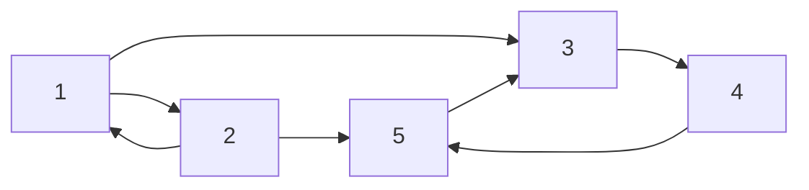

> 📅 2026-09-29（周二）第 3–4 节 ｜ 📖 教材：§1.3、§1.4（一、二、三）
> 🎞 来源：课堂转写 + 13 张板书（`板书/应用随机过程_2026-09-29_第3-4节/`）

---

### 0. 本讲要点速览

- **状态分类 = 有向图的连通性**：可达、互通、不可约、互通类、闭集、闭类。
- 互通类不闭时，从中出发离开的概率 $$>0$$，但**不一定 $$=1$$**（反例只能出现在无限状态）。
- 首达时 $$\tau_i$$、首入时 $$\sigma_i$$（$$\inf\emptyset=+\infty$$）。
- 一维 SRW：**反射原理** ⟹ $$P_0(\tau_i=n)=\frac in P_0(S_n=i)$$；$$\tau_1<\infty$$ a.s. 但 $$E_0\tau_1=+\infty$$；**反正弦律**。
- **强马氏性**：从首达时（随机时刻）往后看，仍是同一个马氏链。
- 📝 **作业**：教材习题 P51–52 第 1、3 题。10 月 8 日（假期后第一天）**不交作业**。
- 🤔 **思考题**：右漂随机游动被 $$0$$ 吸收的概率（见 §2.3）。

---

### 1. §1.3 状态的分类

把马氏链画成**有向图**：$$p_{ij}>0$$ 就画箭头 $$i\to j$$。本节就是图的"连通性"，只是要用概率语言说清楚。

#### 1.1 可达

> **定义 1.3.1**　若 $$P_i(\exists\,n\ge0,\ \text{s.t. }X_n=j)>0$$，则称 **$$i$$ 可达 $$j$$**，记 $$i\to j$$。

按定义（取 $$n=0$$），**$$i\to i$$ 恒成立**。

**等价条件**（便于检验）：
$$
i\to j\iff\exists\,n\ge0,\ p_{ij}^{(n)}>0\iff j=i\ \text{或}\ \Big(j\neq i,\ \exists\,n\ge1,\ i_0=i,i_1,\dots,i_n=j\ \text{使}\ p_{i_0i_1}\cdots p_{i_{n-1}i_n}>0\Big).
$$

- 第一个 ⟺：把"存在"写成**并集**，
  $$
  p_{ij}^{(n)}\le P_i\Big(\bigcup_n\{X_n=j\}\Big)\le\sum_np_{ij}^{(n)},
  $$
  左边任一项 $$>0$$ ⟹ 中间 $$>0$$ ⟹ 右边和 $$>0$$ ⟹ 某一项 $$>0$$。
- 第二个 ⟺：$$p_{ij}^{(n)}$$ 就是所有长 $$n$$ 的路径概率之和（全概率公式），和 $$>0$$ ⟺ 某条路径概率 $$>0$$，即图上存在 $$i$$ 到 $$j$$ 的有向路径。

#### 1.2 互通、不可约、闭集

> **定义 1.3.3**　若 $$i\to j$$ 且 $$j\to i$$，称 $$i$$ 与 $$j$$ **互通**，记 $$i\leftrightarrow j$$。若 $$S$$ 中所有状态两两互通，称 $$P$$（或 $$S$$、或该马氏链）**不可约**。

- 互通是**等价关系**，把 $$S$$ 划分成若干**互通类** $$[i]=\{j:j\leftrightarrow i\}$$（类比高等代数中的等价类）。
- 不可约 ≈ "连通"。以后几乎所有结论**只在不可约情形下研究**：可约的就切成几块分别做。

> **定义 1.3.4**　若 $$p_{ij}=0$$，$$\forall\,i\in A,\ j\notin A$$，称 $$A$$ 为**闭集**（概率"只进不出"）。**闭类**：既闭又互通的类。

互通与闭没有直接关系：一个互通类可以有向外的箭头。

> **命题 1.3.5**　$$A$$ 为闭集，则 $$P_i(X_n\in A,\ \forall\,n\ge0)=1$$，$$\forall\,i\in A$$。（自行证明。）

> **命题 1.3.7**　$$A$$ 为互通类但不是闭集，则
> $$
> P_i(\exists\,n\ge0,\ X_n\notin A)>0,\qquad\forall\,i\in A.
> $$

**为什么只写 $$>0$$ 而不是 $$=1$$？**

- **$$A$$ 有限时一定 $$=1$$**：不出去就会反复回到"漏口"状态，每次都有固定的正概率漏出去，次数无穷多次必然漏掉（"一直赌下去总有一天会输"）。
- **反例只能在无限状态中**：见下面的思考题。

#### 1.3 🤔 思考题：右漂随机游动的吸收

$$S=\{0,1,2,\dots\}$$，$$0$$ 为**吸收态**；$$i\ge1$$ 时 $$p_{i,i+1}=p$$，$$p_{i,i-1}=q$$，**$$p>q$$**。$$A=\{1,2,\dots\}$$ 互通且不闭。求 $$P_i(\exists\,n,\ X_n=0)$$。

参考答案（补充，非课上给出）

这就是赌徒输光问题把右端 $$b$$ 推到 $$\infty$$。令 $$h_i=P_i(\text{到达 }0)$$，则 $$h_i=ph_{i+1}+qh_{i-1}$$，$$h_0=1$$，取最小非负解得
$$
h_i=\Big(\frac qp\Big)^i<1.
$$
有正概率"跑到 $$+\infty$$ 去"——**无穷远处相当于一个隐含的吸收态**，后面会多次遇到。

#### 1.4 具体判断：画图

例：$$1\leftrightarrow2$$，$$1\to3$$，$$2\to5$$，$$3\to4\to5\to3$$。

- 互通类：$$\{1,2\}$$、$$\{3,4,5\}$$；闭集：$$\{3,4,5\}$$ 与全体 $$S$$；闭类：$$\{3,4,5\}$$。
- 直观：从任何状态出发，最终都会进入 $$\{3,4,5\}$$ 并在其中循环；状态 $$1,2$$ 沿任一轨道只出现**有限次**。

> 📝 题外话：多了解其他学科、培养对其他领域的直观非常重要。对一个领域毫无认知时，犯错几乎是必然的。

---

### 2. §1.4 首达时与强马氏性

#### 2.1 首达时与首入时

轨道 $$\vec X(\omega)=(X_0(\omega),X_1(\omega),\dots)$$。定义
$$
\tau_i(\omega)=\inf\{n\ge0:X_n(\omega)=i\}\quad(\text{首达时}),\qquad\sigma_i=\inf\{n\ge1:X_n=i\}\quad(\text{首入时}),
$$
约定 $$\inf\emptyset=+\infty$$（**随机时刻可以取 $$+\infty$$**）。

- $$X_0\neq i$$ 时，$$\tau_i=\sigma_i$$；$$\sigma_i$$ 专为**从 $$i$$ 出发再回到 $$i$$** 而设。
- 从 $$i$$ 出发绕一圈回到 $$i$$ 的一段轨道称为 **excursion**（游离）。

#### 2.2 一维简单随机游动的首达时

$$\xi_1,\xi_2,\dots$$ i.i.d.，$$P(\xi_i=1)=P(\xi_i=-1)=\tfrac12$$，$$S_0=0$$，$$S_n=\xi_1+\dots+\xi_n$$。

> ⚠️ 本部分的结论与技巧**特定于 SRW**（多为组合问题，与卡特兰数等相关），**不能推广**到一般马氏链。

> **命题 1.4.3（反射原理）**　对 $$i\ge0$$，$$j\ge1$$：
> $$
> P_0(\tau_i<n,\ S_n=i+j)=P_0(\tau_i<n,\ S_n=i-j).
> $$

**证明**：$$i=0$$ 时 $$\tau_0=0$$，由对称性显然。设 $$1\le i<n$$：把 $$\tau_i$$ 之后的轨道关于水平线 $$y=i$$ **翻折**，得到两个事件的轨道之间的**一一对应**；每条轨道的概率都是 $$2^{-n}$$，故概率相等。$$\square$$

> **命题 1.4.4（$$\tau_i$$ 的分布）**　对 $$i\ge1$$：
> $$
> P_0(\tau_i=n)=\frac inP_0(S_n=i).
> $$

**证明**（设 $$n+i$$ 为偶数，否则两边为 $$0$$）：

1. 拆分：$$\{S_n=i\}=\{\tau_i=n\}\ \sqcup\ \{\tau_i<n,\ S_n=i\}$$，后者按 $$S_{n-1}=i\pm1$$ 再拆为 ①、②：
   - ① $$\{\tau_i<n,\ S_{n-1}=i+1,\ S_n=i\}=\{S_{n-1}=i+1,\ S_n=i\}$$（已到过 $$i+1$$，必先经过 $$i$$）；
   - ② $$\{\tau_i<n,\ S_{n-1}=i-1,\ S_n=i\}$$。由反射原理（翻折 $$\tau_i$$ 至 $$n-1$$ 段），② 与 ① 的概率相等。
2. 于是
   $$
   P_0(\tau_i=n)=P_0(S_n=i)-2P_0(S_{n-1}=i+1,\ S_n=i)=P_0(S_n=i)-P_0(S_{n-1}=i+1).
   $$
3. 用组合数计算：$$P_0(S_{n-1}=i+1)=\dfrac{n-i}{n}P_0(S_n=i)$$，相减即得 $$\dfrac inP_0(S_n=i)$$。$$\square$$

> ⚠️ 写出"分布"还不够：**$$\sum_nP_0(\tau_i=n)$$ 是否等于 $$1$$ 需要另外证明**（$$\tau_i$$ 可能以正概率为 $$+\infty$$）；还要关心期望。

> **推论 1.4.5**
> $$
> P_0(\tau_1>2n-1)=P_0(S_{2n}=0).
> $$

**证明**（反射原理再用一次）：$$\{\tau_1\le2n-1\}=\{\tau_1<2n\}$$。对 $$j\ge1$$，
$$
\{\tau_1<2n,\ S_{2n}=1+j\}=\{S_{2n}=1+j\}\ \longleftrightarrow\ \{\tau_1<2n,\ S_{2n}=1-j\}.
$$
对 $$j\ge1$$ 求和得 $$P_0(S_{2n}\ge2)=P_0(\tau_1<2n,\ S_{2n}\le0)$$（$$S_{2n}$$ 为偶数，不可能为 $$1$$）。所以
$$
P_0(\tau_1<2n)=2P_0(S_{2n}\ge2)\overset{\text{对称}}{=}P_0(S_{2n}\neq0).\qquad\square
$$

> **推论 1.4.6**
> $$
> P_0(\tau_1<\infty)=1,\qquad P_0(\sigma_0<\infty)=1,\qquad E_0\tau_1=E_0\sigma_0=+\infty.
> $$

**证明**：由 Stirling 公式，
$$
P_0(\tau_1>2n-1)=\binom{2n}{n}2^{-2n}\sim\frac1{\sqrt{\pi n}}\xrightarrow{n\to\infty}0,
$$
故 $$\tau_1<\infty$$ a.s.；又
$$
E_0\tau_1=1+\sum_{n=1}^{\infty}P_0(\tau_1>2n-1)=+\infty
$$
（$$\sum\frac1{\sqrt n}$$ 发散）。对 $$\sigma_0$$：第一步走到 $$\pm1$$，再由对称性，$$\sigma_0\overset d=1+\tau_1$$。$$\square$$

💡 **反直观**：一定会到达 $$1$$（或回到 $$0$$），但平均所需时间是无穷。

> **命题 1.4.8（反正弦律）**　令
> $$
> \varepsilon_n\triangleq\max\{m\le n:S_m=0\}\qquad(\text{到 }n\text{ 为止最后一次在 }0\text{ 的时刻}),
> $$
> 则对 $$\delta\in(0,1)$$：
> $$
> \lim_{n\to\infty}P_0(\varepsilon_n\le\delta n)=\frac2\pi\arcsin\sqrt\delta.
> $$

**证明思路**（课上做法，比教材的 Stirling 硬算更能看出结论从何而来；部分步骤以中心极限定理作启发式说明）：

1. 令 $$m=\lfloor\delta n\rfloor$$。$$\{\varepsilon_n\le\delta n\}=\{S_r\neq0,\ \forall\,\delta n<r\le n\}$$。对 $$S_m$$ 全概率分解，再用马氏性：
   $$
   P_0(\varepsilon_n\le\delta n)=\sum_iP_0(S_m=i)\,P_i(\tau_0>n-m)=1-\sum_iP_0(S_m=i)\,P_0(\tau_i\le n-m)
   $$
   （由平移与对称，$$P_i(\tau_0\le k)=P_0(\tau_i\le k)$$）。
2. 对 $$i\ge1$$，按 $$S_{n-m}$$ 与 $$i$$ 的大小关系拆分并用反射原理：
   $$
   \{\tau_i\le n-m\}=\{S_{n-m}=i\}\sqcup\{\tau_i<n-m,\ S_{n-m}>i\}\sqcup\{\tau_i<n-m,\ S_{n-m}<i\},
   $$
   后两者概率相等，且前者中"$$\tau_i<n-m$$"可去掉，故
   $$
   P_0(\tau_i\le n-m)=P_0(S_{n-m}=i)+2P_0(S_{n-m}>i)=P_0(S_{n-m}=i)+P_0(|S_{n-m}|>|i|).
   $$
   负的 $$i$$ 对称，$$i=0$$ 时等式也成立（两边都为 $$1$$）。
3. 代入后，$$\sum_iP_0(S_m=i)P_0(S_{n-m}=i)\to0$$（由 CLT/局部估计，两个 $$\sim\sqrt n$$ 尺度分布"恰好相等"的概率趋于 $$0$$）。
4. 关键一步：取 $$\{T_n\}\overset d=\{S_n\}$$ 且与 $$\{S_n\}$$ **独立**，则
   $$
   \sum_iP_0(S_m=i)P_0(|S_{n-m}|>|i|)=P\big(|T_{n-m}|>|S_m|\big)=P\Big(\frac{|T_{n-m}|/\sqrt{n-m}}{|S_m|/\sqrt m}>\frac{\sqrt m}{\sqrt{n-m}}\Big),
   $$
   其中 $$\dfrac{\sqrt m}{\sqrt{n-m}}\to\sqrt{\dfrac{\delta}{1-\delta}}$$——这正是命题设为 $$\delta n$$ 的原因。
5. 由 CLT，分子分母收敛到**两个独立标准正态的绝对值**。$$(Z_1,Z_2)$$ 的方向角均匀分布，计算得
   $$
   \lim_{n\to\infty}P_0(\varepsilon_n\le\delta n)=P\Big(\frac{|Z_1|}{|Z_2|}\le\sqrt{\tfrac{\delta}{1-\delta}}\Big)=\frac2\pi\arcsin\sqrt\delta.
   $$

本质：$$S_n/\sqrt n$$ 越来越像正态分布，反正弦律由此产生。

#### 2.3 强马氏性（§1.4 三）

记 $$\tau=\tau_i$$，设 $$P(\tau<\infty)>0$$。在 $$\{\tau<\infty\}$$ 上令
$$
(Y_0,Y_1,Y_2,\dots)\triangleq(X_\tau,X_{\tau+1},X_{\tau+2},\dots),\qquad\text{即 }Y_k(\omega)=X_{\tau(\omega)+k}(\omega).
$$

- 理解：对不同的 $$\omega$$，$$\tau(\omega)$$ 不同（可能是 $$2$$，也可能是 $$10000$$）。这里做的是**随机对齐**：把每条轨道首次到达 $$i$$ 的时刻都对齐为新的时刻 $$0$$，再看之后的发展。
- **强马氏性**：$$\{Y_n\}$$ 是从 $$i$$ 出发、转移矩阵为 $$P$$ 的马氏链，与 $$\{X_n\}$$（从 $$i$$ 出发时）同分布。"强"不是加了更强的条件，而是模型本身就蕴含的更强性质：**固定时刻 → 随机时刻**。
- 直观：从 $$i$$ 出发，不管多久回到 $$i$$，回来后都"重新开始"，没有记忆。
- **威力**：例如"从 $$i$$ 出发、永不回来之前回到 $$i$$ 的次数"——每次回来都重新开始，于是次数服从**几何分布**。这将大大拓展 §1.5–1.7 的工具。
- 证明：用 $$\{\tau=k\}$$ 把事件拆碎，在每一块上用普通马氏性，再求和。"纯体力活"。
